# compsol 💻📈
compsol : | Computing Solutions | Application Performance Upgrade, Workload, EC2, Instance Type, AWS Systems Manager (SSM), Session Manager, Console |

## Objectives
- Filter & identify EC2 instance type based on workload attributes
- Connect to EC2 instance using Session Manager & view its metadata
- Start & stop EC2 instance using Amazon EC2 console
- Change EC2 instance type to larger (m4.large) general purpose instance

## Computing Solutions 

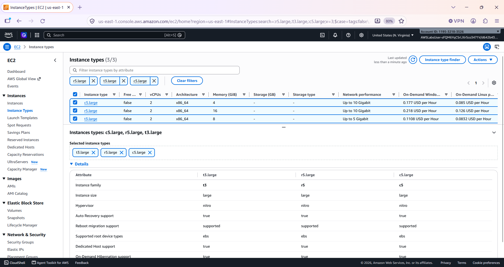

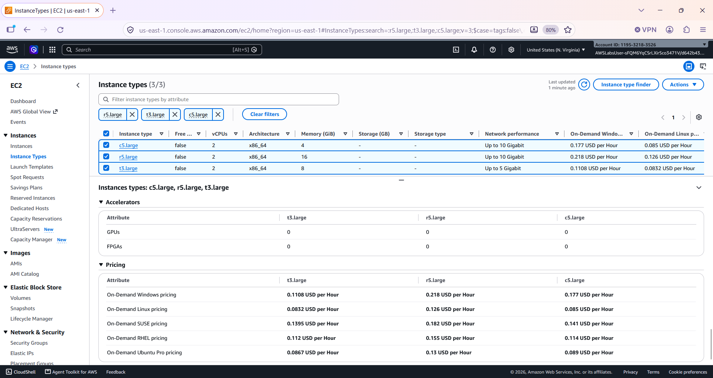

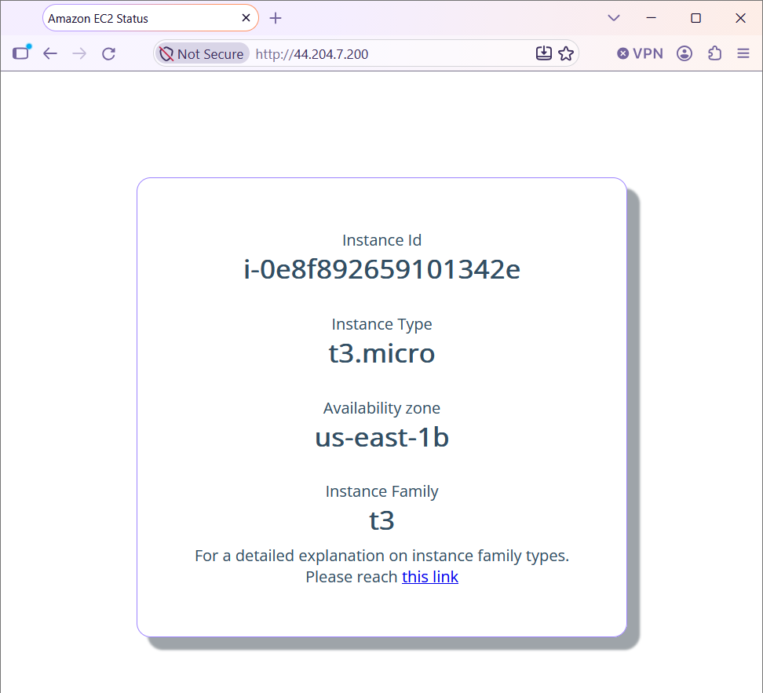

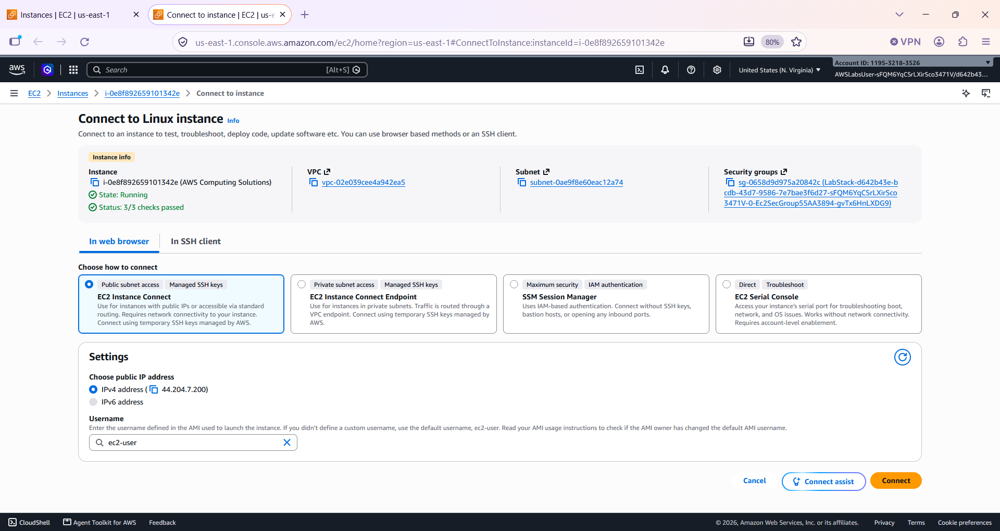

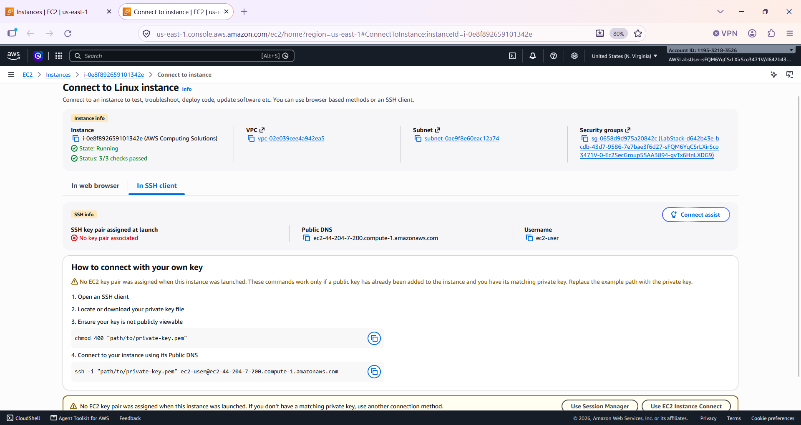

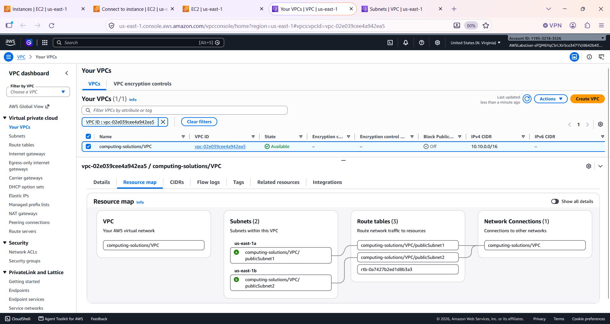

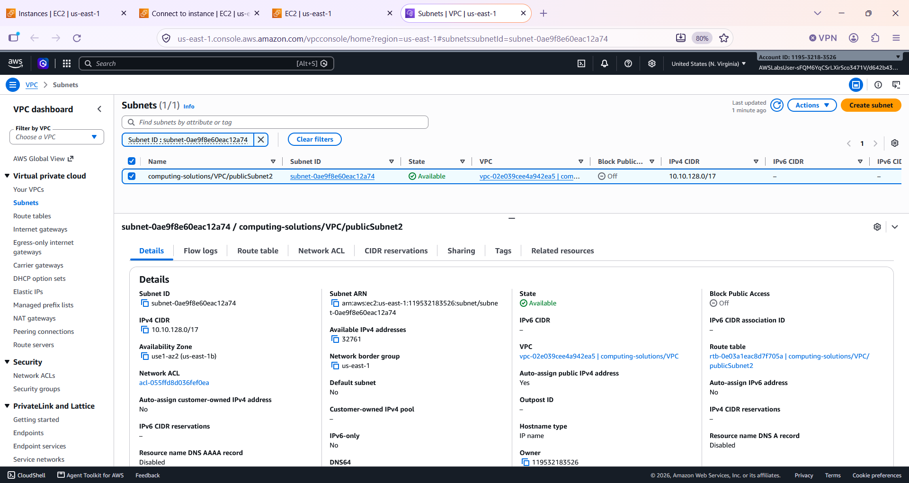

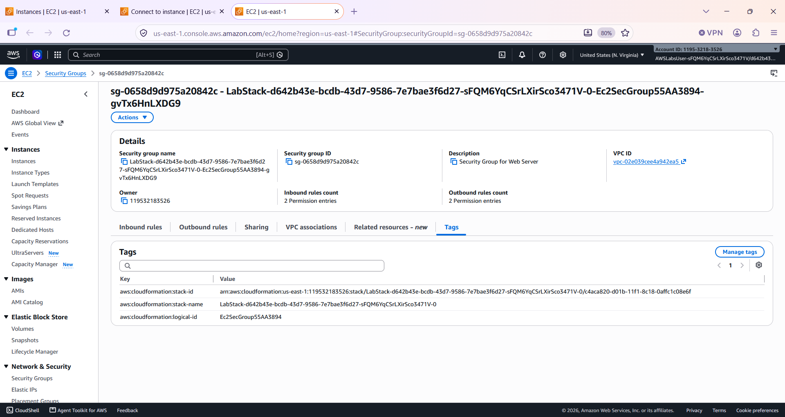

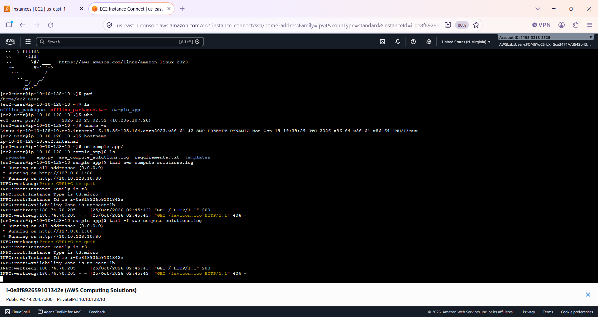

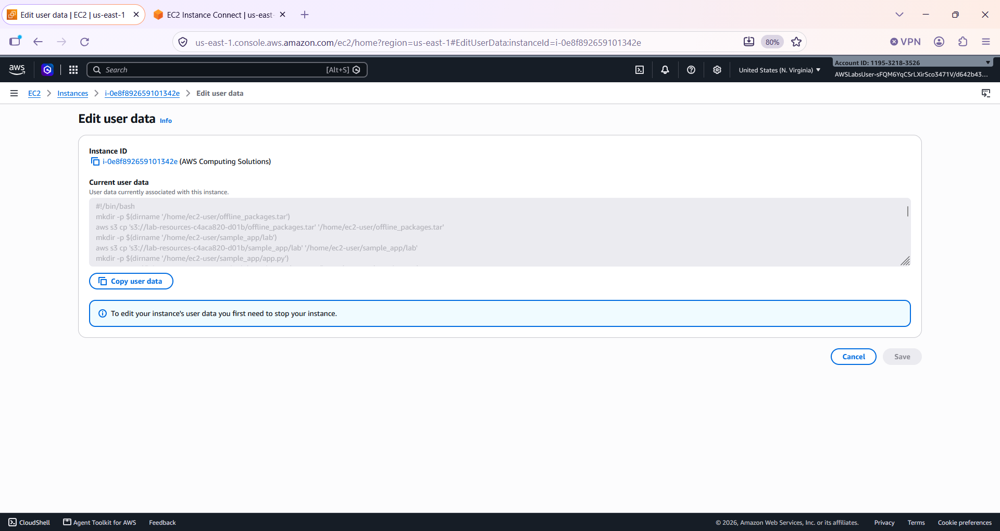

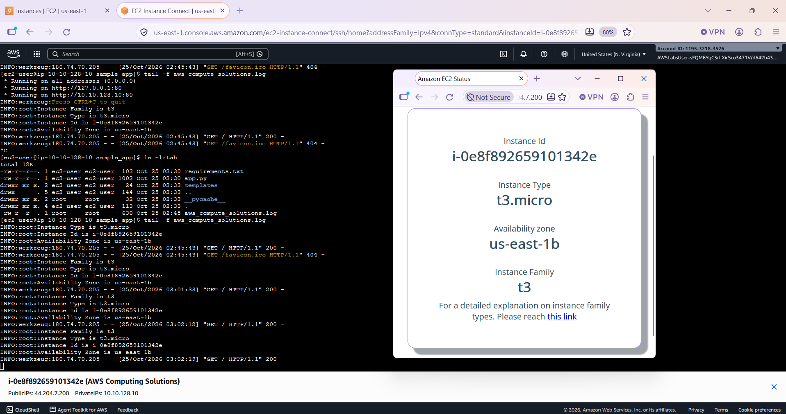

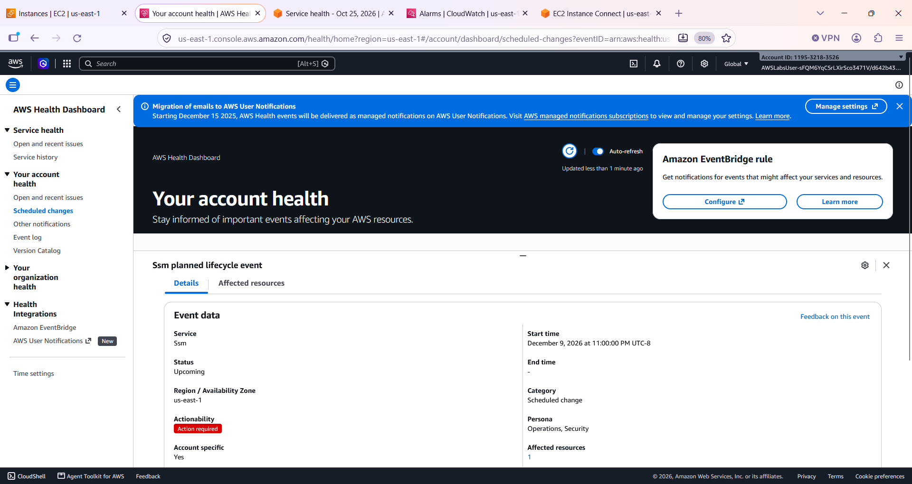

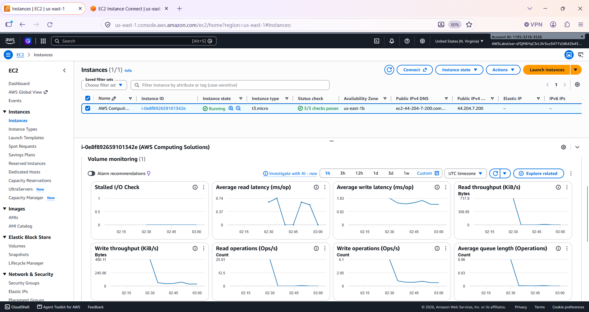

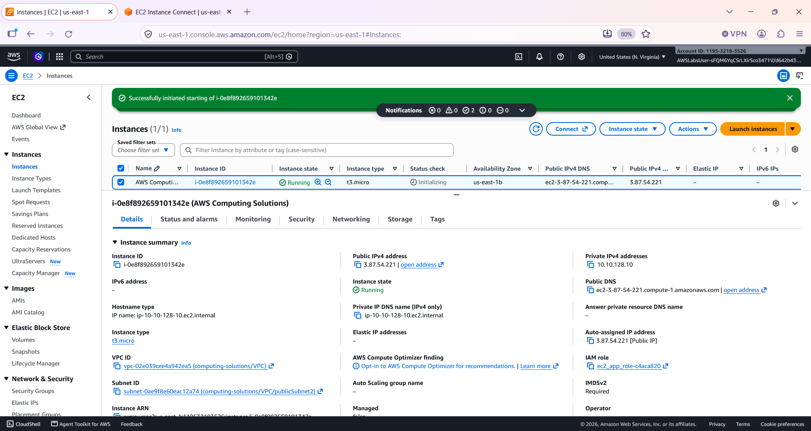

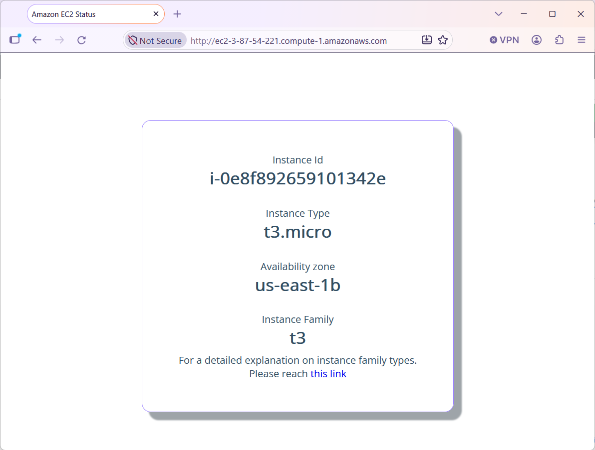

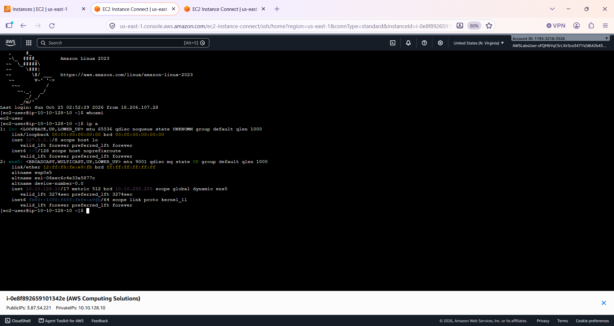

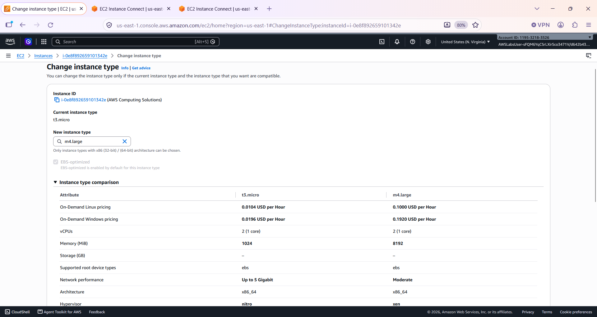

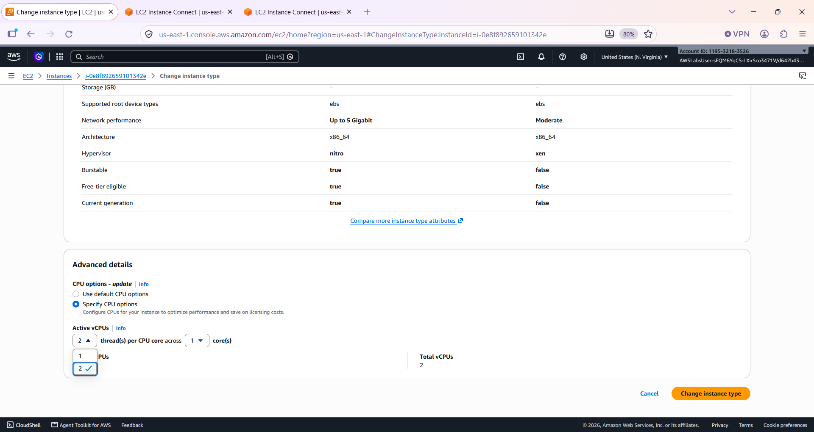

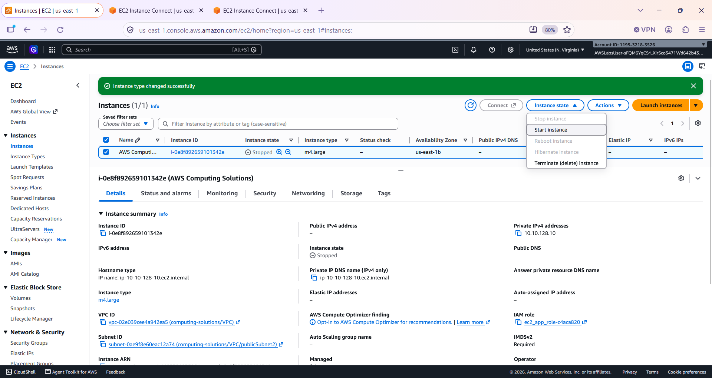

